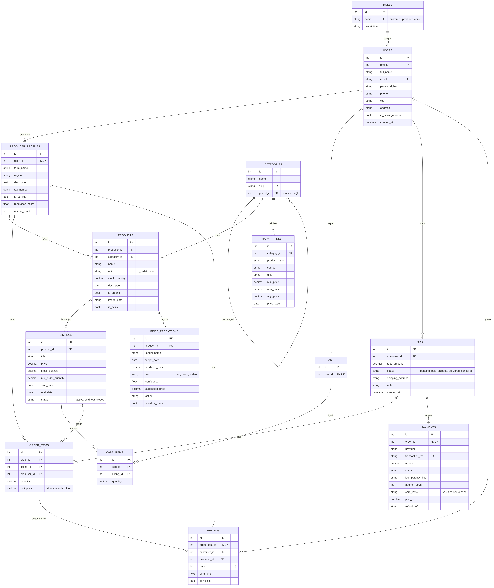
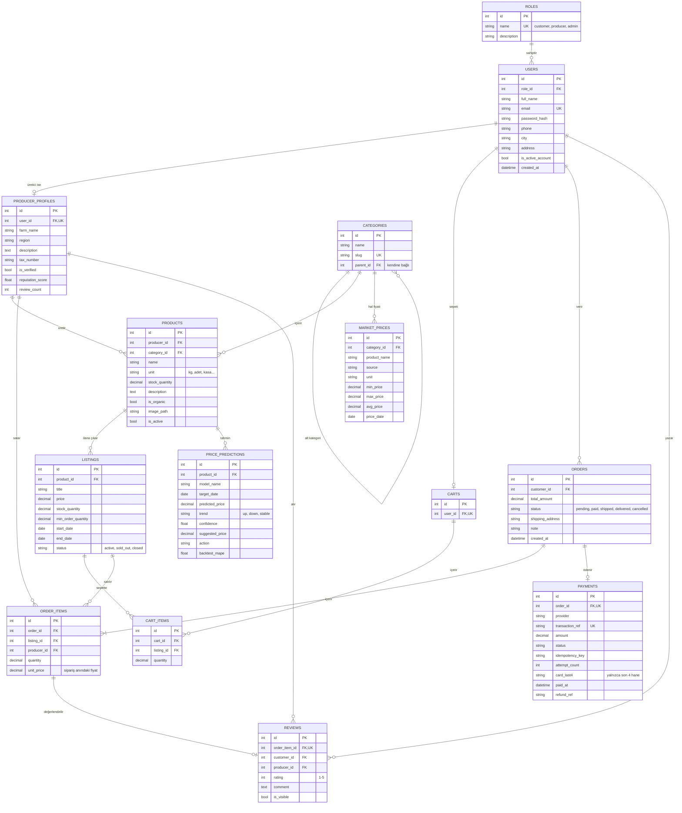

# ER Diyagramı (Hafta 3-4, Hafta 11 itibarıyla güncel)

Veritabanında **14 tablo** vardır. Aşağıdaki diyagram `app/models/` içindeki modellerden çıkarılmıştır.
GitHub ve VS Code (Markdown Preview Mermaid Support eklentisiyle) Mermaid kodunu doğrudan çizer;
aynı diyagramın resmi: [`er_diyagrami.png`](er_diyagrami.png).

## Gösterim

| Sembol | Anlamı |
|---|---|
| `||--o{` | bire-çok (bir rolün sıfır veya çok kullanıcısı) |
| `||--o|` | bire-bir, isteğe bağlı (her kullanıcının en fazla bir üretici profili) |
| `||--|{` | bire-çok, en az bir (siparişte en az bir kalem olmalı) |
| PK / FK / UK | birincil anahtar / yabancı anahtar / benzersiz |

## Önemli tasarım kararları

- **Rol ayrı tablo:** `roles` → `users` (1-N). Yetki kontrolü `@role_required` ile rol adına göre yapılır.
- **Üretici profili ayrı tablo:** Yalnızca üreticilerin çiftlik bilgisi vardır; `users` tablosu boş sütunlarla şişmez (1-1, `user_id` UNIQUE).
- **Ürün ≠ İlan:** Ürün üreticinin elindeki malı (toplam stok), ilan ise satışa çıkarılan kısmını (fiyat, satış stoğu, tarih) tutar.
  Aynı ürün farklı fiyatlarla birden çok kez ilana çıkabilir.
- **Kategori kendine bağlı:** `parent_id` ile ağaç yapısı (Sebze → Domates).
- **Sipariş kalemi fiyatı kopyalar:** `order_items.unit_price` sipariş anındaki fiyattır; ilan fiyatı sonradan değişse de eski sipariş bozulmaz.
  `producer_id` da kaleme yazılır; böylece üretici "bana gelen siparişler"i uzun JOIN zinciri olmadan bulur.
- **Bir siparişin en fazla bir ödemesi:** `payments.order_id` UNIQUE; çift çekime karşı `idempotency_key`. Kart numarasının yalnızca son 4 hanesi saklanır.
- **Değerlendirme kaleme bağlı:** `reviews.order_item_id` UNIQUE → aynı alışveriş iki kez puanlanamaz; yalnızca teslim edilen sipariş değerlendirilebilir.
- **Hal fiyatı kategoriye bağlı:** `market_prices` tablosunda (`product_name`, `source`, `price_date`) üçlüsü benzersizdir; yapay zekâ tahminleri `price_predictions` tablosundadır.
- Her tabloda `id`, `created_at`, `updated_at` vardır (`BaseModel`); diyagram kalabalık olmasın diye çoğunda gösterilmedi.
